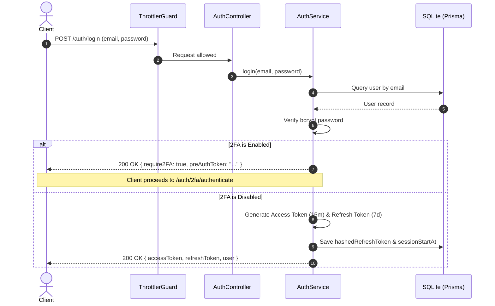
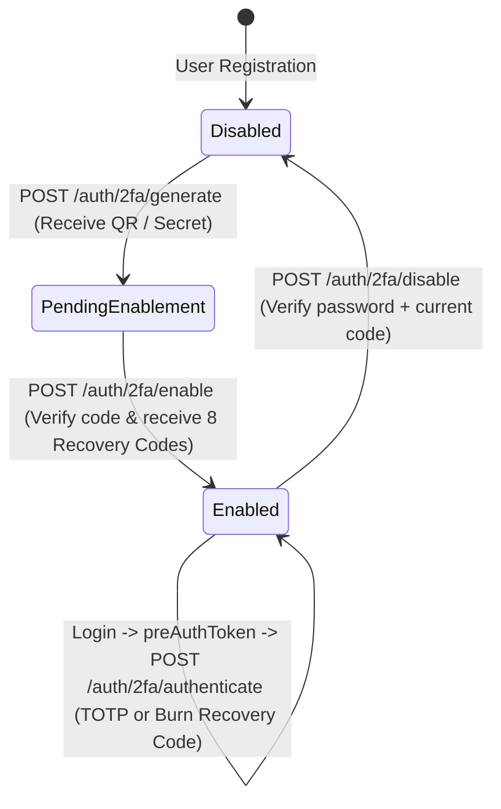

# 🔐 NestJS Authentication & Authorization API

[](https://nestjs.com/)
[](https://www.typescriptlang.org/)
[](https://www.prisma.io/)
[](https://www.sqlite.org/)
[](https://vitest.dev/)
[](https://oxc.rs/)

A production-grade, modular Authentication and User Management API built with **NestJS 12**, **Prisma ORM 7**, and **TypeScript (ESM)**. Features dual-token JWT authentication with token rotation, multi-factor authentication (TOTP 2FA) with single-use recovery codes, role-based access control (RBAC), session activity tracking, granular rate limiting, and structured error responses.

---

## 📑 Table of Contents

- [Key Features](#-key-features)
- [Architecture & Flow](#-architecture--flow)
  - [Authentication Flow](#authentication-flow)
  - [Two-Factor Authentication (2FA) Lifecycle](#two-factor-authentication-2fa-lifecycle)
- [Project Structure](#-project-structure)
- [Tech Stack](#-tech-stack)
- [Getting Started](#-getting-started)
  - [Prerequisites](#prerequisites)
  - [Environment Configuration](#environment-configuration)
  - [Database Setup](#database-setup)
  - [Running the Application](#running-the-application)
- [API Reference](#-api-reference)
  - [1. Authentication Endpoints (`/auth`)](#1-authentication-endpoints-auth)
  - [2. Two-Factor Authentication (`/auth/2fa`)](#2-two-factor-authentication-auth2fa)
  - [3. User Management Endpoints (`/user`)](#3-user-management-endpoints-user)
- [Security Implementations](#-security-implementations)
- [Testing & Quality Assurance](#-testing--quality-assurance)
- [License](#-license)

---

## 🚀 Key Features

- **Dual-Token Authentication (JWT)**:
  - Short-lived Access Tokens (15 min) for secure request authorization.
  - Long-lived Refresh Tokens (7 days) hashed via `bcrypt` in SQLite for rotation and revocation.
- **Two-Factor Authentication (TOTP / RFC 6238)**:
  - Authenticator app pairing (Google Authenticator, Authy, 1Password) via QR Code data URI.
  - Temporary pre-auth token gating before full session issuance.
  - 8 single-use cryptographically random recovery codes (burned automatically upon use in an atomic transaction).
  - Secure 2FA deactivation requiring password and current TOTP validation.
- **Session Management & Activity Tracking**:
  - Live session tracking (`sessionStartAt`, `lastRefreshRequestAt`).
  - Active session monitoring endpoint for administrators with human-readable elapsed activity times.
  - Instant session revocation on logout and password change.
- **Role-Based Access Control (RBAC)**:
  - Built-in roles: `USER` and `ADMIN`.
  - Guard-level role validation (`AdminGuard`) for protected administration endpoints.
- **Throttling & Rate Limiting**:
  - Global baseline limit (15 requests/min) powered by `@nestjs/throttler`.
  - Sensitive endpoint overrides (e.g. 5 registration attempts/hour, 20 status changes/min).
- **Prisma ORM 7 Integration**:
  - Configured with `@prisma/adapter-better-sqlite3` for fast native SQLite operations.
  - Clean separation of schema and typed client outputs.
- **Observability & Error Handling**:
  - Global `LoggingInterceptor` recording request method, path, and execution latency.
  - Centralized `HttpExceptionFilter` ensuring uniform JSON error envelopes across all endpoints.

---

## 🏛 Architecture & Flow

### Authentication Flow



### Two-Factor Authentication (2FA) Lifecycle



---

## 📁 Project Structure

```text
auth-api/
├── prisma/
│   ├── migrations/               # Prisma database migration history
│   └── schema.prisma             # Database schema (User, RecoveryCode, Role enum)
├── src/
│   ├── auth/
│   │   ├── dto/
│   │   │   ├── login.dto.ts      # Login request payload validation
│   │   │   └── register.dto.ts   # Registration payload validation
│   │   ├── auth.controller.ts    # Authentication & 2FA route handlers
│   │   ├── auth.module.ts        # Auth dependency injection wiring
│   │   └── auth.service.ts       # Auth business logic (JWT, TOTP, sessions)
│   ├── user/
│   │   ├── dto/
│   │   │   ├── create-admin.dto.ts
│   │   │   └── update-user.dto.ts
│   │   ├── user.controller.ts    # User & admin route handlers
│   │   ├── user.module.ts        # User module definition
│   │   └── user.service.ts       # User CRUD & pagination logic
│   ├── guards/
│   │   ├── admin.guard.ts        # Checks ADMIN role permissions
│   │   └── jwt.guard.ts          # Verifies Bearer access tokens
│   ├── decorators/
│   │   └── current-user.decorator.ts # Injects authenticated TokenUser
│   ├── filters/
│   │   └── http-exception.filter.ts  # Standardizes all HTTP exceptions
│   ├── interceptors/
│   │   └── logging.interceptor.ts    # Logs incoming requests and timings
│   ├── prisma/
│   │   ├── prisma.module.ts      # Global Prisma module
│   │   └── prisma.service.ts     # PrismaClient instantiation with SQLite adapter
│   ├── app.controller.ts         # Root controller
│   ├── app.module.ts             # Application root module (Guards, Throttler, Config)
│   ├── app.service.ts            # Root service
│   ├── global.types.ts           # Shared TypeScript interfaces (e.g. TokenUser)
│   └── main.ts                   # Application bootstrap entrypoint
├── test/
│   └── app.e2e-spec.ts           # End-to-end test suite
├── .env                          # Local environment variables
├── package.json                  # NPM scripts & dependencies
├── prisma7.config.ts             # Prisma ORM 7 runtime configuration
├── tsconfig.json                 # TypeScript compiler configuration
└── vitest.config.ts              # Vitest test runner configuration
```

---

## 🛠 Tech Stack

| Technology | Purpose |
|---|---|
| **[NestJS 12](https://nestjs.com/)** | Extensible enterprise Node.js web framework |
| **[TypeScript 6 (ESM)](https://www.typescriptlang.org/)** | Strongly typed JavaScript runtime |
| **[Prisma ORM 7](https://www.prisma.io/)** | Type-safe query builder and database migration engine |
| **[better-sqlite3](https://github.com/WiseLibs/better-sqlite3)** | Fast native SQLite driver adapter |
| **[@nestjs/jwt](https://github.com/nestjs/jwt)** | JWT signing, verification, and decoding utilities |
| **[otplib](https://github.com/yeojinj/otplib)** | Time-based One-Time Password (TOTP) algorithm (RFC 6238) |
| **[qrcode](https://github.com/soldair/node-qrcode)** | QR code Data URI generation for authenticator apps |
| **[bcrypt](https://github.com/kelektiv/node.bcrypt.js)** | Password and token salting & hashing |
| **[@nestjs/throttler](https://github.com/nestjs/throttler)** | Rate limiting and brute-force mitigation |
| **[class-validator](https://github.com/typestack/class-validator)** | Declarative request payload validation |
| **[Vitest 4](https://vitest.dev/)** | High-performance unit and integration test runner |
| **[Oxlint](https://oxc.rs/)** | Ultra-fast TypeScript & JavaScript linter |

---

## 🏁 Getting Started

### Prerequisites

- **Node.js**: `v20.x` or higher
- **npm**: `v10.x` or higher

### Environment Configuration

Create a `.env` file in the project root with the following configuration:

```env
PORT=3000

# JWT Configuration
JWT_ACCESS_SECRET="your-access-secret-key"
JWT_ACCESS_EXPIRES_IN="15m"

JWT_REFRESH_SECRET="your-refresh-secret-key"
JWT_REFRESH_EXPIRES_IN="7d"

# Two-Factor Authentication
JWT_MFA_SECRET="your-mfa-pre-auth-secret-key"
MFA_APP_NAME="AuthAPI"

# Database Connection (SQLite)
DATABASE_URL="file:./dev.db"
```

### Database Setup

Initialize the SQLite database and generate the Prisma Client:

```bash
# Run migrations
npx prisma migrate dev

# Generate typed Prisma client
npx prisma generate
```

### Running the Application

```bash
# Development mode with hot-reload
npm run start:dev

# Production build & start
npm run build
npm run start:prod
```

The application will be accessible at `http://localhost:3000`.

---

## 📡 API Reference

All requests returning errors adhere to a uniform structure:

```json
{
  "success": false,
  "statusCode": 401,
  "timeStamp": "2026-10-28T11:25:00.000Z",
  "path": "/auth/login",
  "method": "POST",
  "error": "Invalid Email or password"
}
```

---

### 1. Authentication Endpoints (`/auth`)

#### Register User
- **`POST /auth/register`**
- **Auth**: Public
- **Rate Limit**: 5 requests / 1 hour
- **Body**:
  ```json
  {
    "name": "Jane Doe",
    "email": "jane@example.com",
    "password": "strongPassword123"
  }
  ```
- **Response `201 Created`**:
  ```json
  {
    "message": "User Registered successfully",
    "user": {
      "id": "uuid-v4",
      "email": "jane@example.com",
      "name": "Jane Doe",
      "role": "USER"
    }
  }
  ```

#### Login
- **`POST /auth/login`**
- **Auth**: Public
- **Rate Limit**: 30 requests / 30 mins
- **Body**:
  ```json
  {
    "email": "jane@example.com",
    "password": "strongPassword123"
  }
  ```
- **Response `200 OK` (Standard)**:
  ```json
  {
    "user": {
      "id": "uuid-v4",
      "name": "Jane Doe",
      "role": "USER"
    },
    "refreshToken": "ey...",
    "accessToken": "ey..."
  }
  ```
- **Response `200 OK` (If 2FA is Enabled)**:
  ```json
  {
    "require2FA": true,
    "message": "Two-Factor Authentication code required",
    "preAuthToken": "ey..."
  }
  ```

#### Refresh Access Token
- **`POST /auth/refresh`**
- **Auth**: Public
- **Body**:
  ```json
  {
    "refreshToken": "ey..."
  }
  ```
- **Response `200 OK`**:
  ```json
  {
    "message": "Successfully refreshed the access token",
    "newAccessToken": "ey...",
    "refreshExpiresAt": "Nov 04 2026 16:50:00"
  }
  ```

#### Logout
- **`POST /auth/logout`**
- **Auth**: `Bearer <accessToken>`
- **Response `200 OK`**:
  ```json
  {
    "message": "Successfully logged out."
  }
  ```

#### Check Session Status
- **`POST /auth/session`**
- **Auth**: Public
- **Rate Limit**: 15 requests / 1 min
- **Body**:
  ```json
  {
    "id": "user-uuid"
  }
  ```
- **Response `200 OK`**:
  ```json
  {
    "message": "Session Active"
  }
  ```

#### Change Password
- **`POST /auth/change-password`**
- **Auth**: `Bearer <accessToken>`
- **Body**:
  ```json
  {
    "oldPassword": "currentPassword123",
    "newPassword": "newSecurePassword456"
  }
  ```
- **Response `200 OK`**:
  ```json
  {
    "message": "Successfully Changed Password."
  }
  ```
  *(Note: Automatically clears active refresh tokens upon password change).*

---

### 2. Two-Factor Authentication (`/auth/2fa`)

#### Generate 2FA Secret & QR Code
- **`POST /auth/2fa/generate`**
- **Auth**: `Bearer <accessToken>`
- **Response `200 OK`**:
  ```json
  {
    "secret": "JBSWY3DPEHPK3PXP",
    "url": "otpauth://totp/AuthAPI:jane@example.com?secret=...",
    "qrCode": "data:image/png;base64,...",
    "message": "Scan the QR code in Authenticator app like Google Authenticator or Authy, then verify with /auth/2fa/enable"
  }
  ```

#### Enable 2FA
- **`POST /auth/2fa/enable`**
- **Auth**: `Bearer <accessToken>`
- **Body**:
  ```json
  {
    "code": "123456"
  }
  ```
- **Response `200 OK`**:
  ```json
  {
    "message": "2FA successfully enabled! Save your recovery codes in safe place. They will only be show once.",
    "recoveryCodes": [
      "a1b2-c3d4e5",
      "f6g7-h8i9j0",
      "k1l2-m3n4o5",
      "p6q7-r8s9t0",
      "u1v2-w3x4y5",
      "z6a7-b8c9d0",
      "e1f2-g3h4i5",
      "j6k7-l8m9n0"
    ]
  }
  ```

#### Authenticate 2FA (Login Completion)
- **`POST /auth/2fa/authenticate`**
- **Auth**: Public
- **Body**:
  ```json
  {
    "preAuthToken": "ey...",
    "code": "123456"
  }
  ```
  *(Accepts either the current 6-digit TOTP code or any unused 8-digit recovery code).*
- **Response `200 OK`**:
  ```json
  {
    "message": "Two-Factor authentication successfull!",
    "user": {
      "id": "uuid-v4",
      "email": "jane@example.com",
      "role": "USER"
    },
    "refreshToken": "ey...",
    "accessToken": "ey..."
  }
  ```

#### Disable 2FA
- **`POST /auth/2fa/disable`**
- **Auth**: `Bearer <accessToken>`
- **Body**:
  ```json
  {
    "password": "currentPassword123",
    "code": "123456"
  }
  ```
- **Response `200 OK`**:
  ```json
  {
    "message": "Two-Factor authentication has been successfully disabled."
  }
  ```

---

### 3. User Management Endpoints (`/user`)

#### Get Current User Profile
- **`GET /user/me`**
- **Auth**: `Bearer <accessToken>`
- **Response `200 OK`**:
  ```json
  {
    "user": {
      "id": "uuid-v4",
      "email": "jane@example.com",
      "name": "Jane Doe",
      "isActive": true,
      "createdAt": "2026-10-28T09:00:00.000Z",
      "updatedAt": "2026-10-28T10:15:00.000Z"
    }
  }
  ```

#### Update Profile
- **`POST /user/update`**
- **Auth**: `Bearer <accessToken>`
- **Body**:
  ```json
  {
    "name": "Jane Smith"
  }
  ```
- **Response `200 OK`**:
  ```json
  {
    "message": "User details updated successfully."
  }
  ```

#### Create Admin Account (Admin Only)
- **`POST /user/create/admin`**
- **Auth**: `Bearer <adminAccessToken>`
- **Rate Limit**: 20 requests / 30 mins
- **Body**:
  ```json
  {
    "name": "Admin Superuser",
    "email": "admin@example.com",
    "password": "adminSecurePassword123"
  }
  ```
- **Response `201 Created`**:
  ```json
  {
    "message": "Admin created succesfully",
    "newAdmin": {
      "id": "uuid-v4",
      "email": "admin@example.com",
      "name": "Admin Superuser",
      "role": "ADMIN"
    }
  }
  ```

#### Toggle User Status (Admin Only)
- **`POST /user/status/:state/:id`**
- **Auth**: `Bearer <adminAccessToken>`
- **URL Parameters**:
  - `:state`: `activate` or `deactivate`
  - `:id`: Target user UUID
- **Rate Limit**: 20 requests / 1 min
- **Response `200 OK`**:
  ```json
  {
    "message": "User: target@example.com successfully deactivated."
  }
  ```

#### List All Users (Admin Only)
- **`GET /user/all`**
- **Auth**: `Bearer <adminAccessToken>`
- **Rate Limit**: 30 requests / 1 min
- **Query Parameters**:
  - `search` *(optional)*: Email substring filter
  - `page` *(optional, default: 1)*: Page number (10 items per page)
  - `role` *(optional)*: `admin` (`a`) or `user` (`u`)
  - `active` *(optional)*: `true` or `false`
- **Response `200 OK`**:
  ```json
  {
    "totalUsers": 25,
    "filteredTotalUserCount": 1,
    "totalPage": 3,
    "pageNumber": 1,
    "hasNextPage": true,
    "limit": 10,
    "note": "",
    "users": [
      {
        "id": "uuid-v4",
        "email": "jane@example.com",
        "name": "Jane Smith",
        "role": "USER",
        "isActive": true,
        "createdAt": "2026-10-28T09:00:00.000Z",
        "updatedAt": "2026-10-28T10:15:00.000Z"
      }
    ]
  }
  ```

#### Monitor Active Sessions (Admin Only)
- **`GET /auth/all/current/sessions`**
- **Auth**: `Bearer <adminAccessToken>`
- **Query Parameters**:
  - `min` *(optional)*: Filter sessions active within the last `N` minutes
- **Response `200 OK`**:
  ```json
  {
    "message": "Fetched all current sessions",
    "totalActiveSessions": 3,
    "recentMin": 60,
    "totalSessions": 3,
    "sessions": [
      {
        "id": "uuid-v4",
        "email": "jane@example.com",
        "role": "USER",
        "sessionStartAt": "Wed Oct 28 2026 16:00:00 GMT+0530",
        "lastRefreshTime": "Wed Oct 28 2026 16:30:00 GMT+0530",
        "lastRefreshAt": "00:22:15 ago"
      }
    ]
  }
  ```

---

## 🔒 Security Implementations

1. **Bcrypt Token Hashing in Database**: Refresh tokens are treated like passwords. Instead of storing plaintext tokens, the database stores a `bcrypt` hash of the refresh token. Even in the event of a database dump, issued refresh tokens cannot be used by an attacker.
2. **Atomic Recovery Code Burn**: When a recovery code is used during 2FA authentication, it is flagged as `used` within a database transaction alongside session updates, preventing reuse or replay attacks.
3. **Decoupled 2FA Verification**: Logins with 2FA enabled issue a short-lived `preAuthToken` scoped solely for `/auth/2fa/authenticate`. No standard protected resource can be accessed until the second factor is verified.
4. **Session Invalidation**: Changing passwords or logging out invalidates the stored refresh token hash immediately, preventing zombie sessions.
5. **Throttling Protection**: Tight rate-limits protect against brute force attacks on `/auth/register`, `/auth/login`, and administrative user status endpoints.

---

## 🧪 Testing & Quality Assurance

```bash
# Run unit tests with Vitest
npm run test

# Run tests in watch mode
npm run test:watch

# Run test coverage report
npm run test:cov

# Run end-to-end (e2e) tests
npm run test:e2e

# Run type-aware linting with Oxlint
npm run lint

# Format code with Prettier
npm run format
```

---

## 📄 License

This project is licensed under the [UNLICENSED](LICENSE) license.
